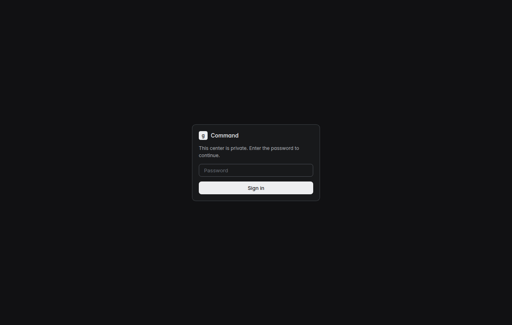
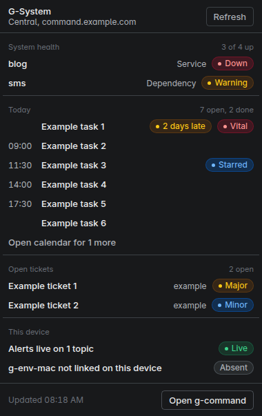

# g-command-mac

The desktop app for G-System. It wraps g-command-web, the dashboard that runs on the central server, in a native window, and it adds the two things a browser tab can't do well: it raises a native notification when the alert spine fires, and it keeps a status panel in the menu bar.

G-System is my agentic development setup. One central server runs the knowledge brain, the alert spine and the dashboard, and other hosts hang off it. This app is one more subscriber on that spine, next to the phone and the TV.

This repo is open source under the GNU Affero General Public License v3.0.



## What it does

- **Main window.** Loads g-command-web from a list of servers you configure. Each server gets its own persistent session, so you sign in once and stay signed in. Links that leave your servers open in the default browser.
- **Notifications.** Holds an ntfy stream open for the topics you set, and turns each message into a native notification. Clicking it opens the right dashboard page: reminders go to the calendar, service alerts go to the system page, and a message that carries its own click link goes there.
- **Menu-bar panel.** Shows system health, today's open todos and open g-admin tickets, and each row opens the matching page. It refreshes every minute and straight after an alert.
- **g-env-mac link.** If a g-env-mac checkout is on the machine, the panel shows the first line of its `genv status`. If there isn't one, the row says so and nothing else changes.



## Where the data comes from

Nothing here is a new API. The app reads the same endpoints the dashboard already uses.

| Panel section | Endpoint | Auth |
|---|---|---|
| System health | `GET {brainApi}/api/status` | the key in `brainApi`'s path, off the brain's own hosts |
| Today | `GET {brainApi}/api/todos/calendar?date_from=D&date_to=D` | the key in `brainApi`'s path, off the brain's own hosts |
| Open tickets | `GET {server}/api/gadmin_panel/tickets?status=open` | the dashboard's sign-in cookie |
| Alerts | `GET {ntfy}/{topics}/json` | optional bearer token |

The tickets call goes through the central server's own session, so it starts working once you sign in to the dashboard in the main window.

## Settings

All settings live on the device, in `config.json` inside the app's data folder (`~/Library/Application Support/g-command` on a Mac). The file is created with private permissions on first run and is never part of this repo. A new file points at a g-command-web on the same machine (`http://127.0.0.1:8080`), so set `servers` and `brainApi` to your own hosts. The brain API answers bare `/api/` only to its own hosts. From any other device set `brainApi` to the keyed base, `https://api.brain.example.com/k/<key>` (the instance's `BRAIN_PUBLIC`), without a trailing `/api`. The bare host returns 403 on every poll. Use **File, Open settings file** to edit it and **File, Reload settings** to apply it.

```json
{
  "servers": [
    { "id": "central", "name": "Central", "url": "https://command.example.com", "central": true }
  ],
  "activeServer": "central",
  "brainApi": "https://api.brain.example.com/k/<key>",
  "pollSeconds": 60,
  "ntfy": { "server": "https://ntfy.sh", "topics": ["your-topic"], "token": "" },
  "routes": [{ "title": "^deploy", "path": "/crons" }],
  "genvMac": { "path": "" }
}
```

Add more servers to the list and switch between them from the **Server** menu. The one marked `central` feeds the tickets row and receives notification clicks. An ntfy topic on ntfy.sh works like a password, so keep it in this file and nowhere else. `routes` lets you send a notification to a page by matching its title, tags, message or topic, and your rules run before the built-in ones.

## Run it

```sh
npm install
npm start
npm test
```

On Linux as root, start it with `npx electron . --no-sandbox`.

## Build it

```sh
npm run dist:mac      # unsigned dmg and zip, run on a Mac
npm run dist:linux    # unpacked Linux build, used for smoke tests
npm run smoke         # runs the build under xvfb and takes the screenshots
```

The Mac build is unsigned for now. Hardened runtime and entitlements are set up in `electron-builder.yml` and `build/`, and signing and notarisation are switched off until a Developer ID certificate is installed. `CLAUDE.md` lists the steps.

## Licence

Copyright (C) 2026 Gabriel Penman. Licensed under the GNU Affero General Public License v3.0 only, see `LICENSE`.

The fonts, icon glyphs and colour scales in `src/renderer/static/g/` come from other projects and keep their own licences. `THIRD_PARTY_NOTICES` lists them.
